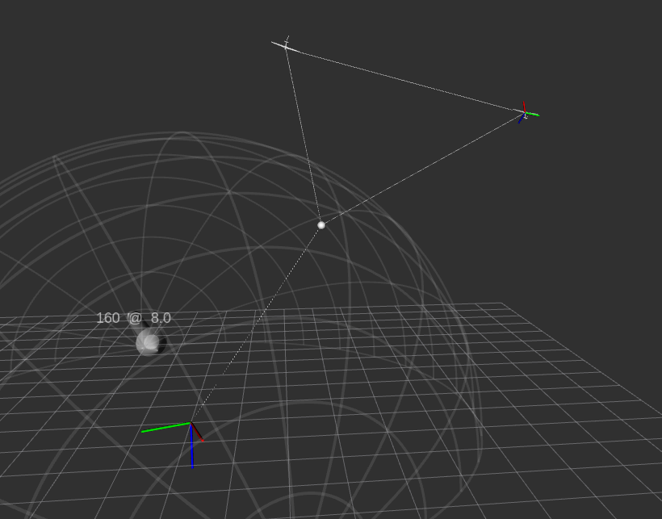

# Simulation and Control of Rigid-Wing Airborne Wind Energy Systems

[](LICENSE)
[-90e3dc.svg)](https://nccr-automation.ch/)

Simulation, control and visualization of fixed-wing aircraft, and in particular of multi-kite airborne wind energy (AWE) systems.

<p align="center">
  
</p>

The dual-kite system showcased in the [publication below](#citing) can be simulated as described in [Run the AWE simulation](#run-the-awe-simulation).

## Requirements

- [ROS 2](https://docs.ros.org/) (developed and tested with Humble)
- `colcon` and a C++ compiler
- (MAVROS: `sudo apt install ros-humble-mavros ros-humble-mavros-extras ros-humble-mavros-msgs`)
- Eigen 3 and yaml-cpp; CasADi for the CasADi model variants
- Git submodules: clone with `git clone --recurse-submodules`, or run `git submodule update --init` afterwards

## Packages

| Package | Description |
|---|---|
| `simulation-flight-ros2` | Simulates the vehicle and tether dynamics (`flight_simulator_node2`), with model parameters loaded from YAML. Core library in `lib/simulation-flight`, including `model-flight`. |
| `visualization-flight-ros2` | Visualizes the simulated vehicle and publishes to RViz (`visualization_flight_node2`, `rviz_config/`). |
| [main-control-flight-ros2](main-control-flight-ros2/README.md) | Fixed-wing controller with AWE-specific navigation, guidance and speed/velocity control (`fixedwing_control_node2`). Core library in `lib/main-control-flight`, including `awe-control`. |

Supporting packages:

| Package | Description |
|---|---|
| `la-common` | Submodule with shared, ROS-free C++ libraries: `main-control-common`, `model-common`, `simulation-common`, `mpc-control-common` (not used by the packages here). The `*-common` directories in the vendored libraries are relative symlinks into it. |

## Run the AWE simulation

To simulate the centrifugally-stiffened dual-kite airborne wind energy system showcased in the publication below, run the following commands (each in a new terminal):

```
# Visualization
rviz2 -d rviz_config/aweVis.rviz
ros2 run visualization_flight_ros2 visualization_flight_node2

# Simulation (winSpeed is 3m above ground)
ros2 run simulation_flight_ros2 flight_simulator_node2 --ros-args -p windSpeed:=4.0

# Control
ros2 run main_control_flight_ros2 fixedwing_control_node2 --ros-args -p mission_mode:=mawe -p activate:=true
```

`visualization-flight-ros2/symlinks.sh` links `rviz_config` to `~/rviz_config`.

## Simulation model

The CasADi multi-kite model (`AweDynamicsCasadi.hpp`) describes fixed-wing kite dynamics with elastic tethers: a ground tether to a connection point, tethers from the connection point to each kite, and lateral (cross-kite) tethers between kites, including tether length dynamics.

Model parameter YAMLs, including a multi-kite configuration (`eg4_xflr-Pvw-YR-Multi.yaml`), live in `simulation-flight-ros2/lib/simulation-flight/lib/model-flight/config`.

## Credits

This project is developed by Johannes Waibel at the [Automatic Control Laboratory](https://www.epfl.ch/labs/la/) at [EPFL](https://www.epfl.ch/), Switzerland.

This work was supported as a part of [NCCR Automation](https://nccr-automation.ch/), a National Centre of Competence in Research, funded by the Swiss National Science Foundation (grant number 51NF40_225155).

## Citing

If you use this code in scientific work, please cite the accompanying paper:

```bibtex
@INPROCEEDINGS{waibel2026highfidelity,
  author={Waibel, Johannes and Brouillon, Jean-Sébastien and Jones, Colin N.},
  booktitle={23rd IFAC World Congress},
  title={High-fidelity Simulation and Control of a Centrifugally-stiffened Airborne Wind Energy System},
  year={2026}
}
```

## License

BSD 2-Clause, see [LICENSE](LICENSE).
